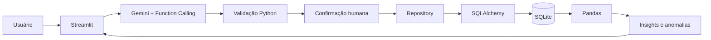

# Agente de IA para Análise de Despesas

Projeto de portfólio em Python que transforma linguagem natural em despesas estruturadas, persiste os dados em banco relacional e gera análises de gastos e alertas estatísticos de anomalias.

A proposta é separar claramente o papel da IA das regras da aplicação: o modelo interpreta a mensagem e sugere dados estruturados; validação, persistência, cálculos e decisões sobre o banco permanecem no código Python.

## Funcionalidades

- Registro conversacional de despesas em português.
- Coleta incremental: se faltar valor, descrição ou data, o agente pergunta em vez de inventar.
- Categorização automática a partir da descrição.
- Extração estruturada com Gemini e **Function Calling**.
- Confirmação humana antes de salvar.
- Persistência com **SQLAlchemy + SQLite**.
- Dashboard mensal, multimês e anual.
- Comparação com período anterior quando aplicável.
- Gráfico de gastos por categoria com drill-down para o histórico.
- Detecção de gastos atípicos por categoria usando **IQR**.
- Revisão de anomalias: manter, corrigir ou excluir.
- Histórico com filtros, busca, edição e exclusão.
- Testes automatizados e CI com GitHub Actions.

## Exemplo

```text
Usuário: Gastei 38,90 no McDonald's ontem.
Agente: Entendi. Confira os dados abaixo antes de eu salvar.

Valor: R$ 38,90
Categoria: Alimentação
Descrição: McDonald's
Data: ontem

[Confirmar e salvar] [Editar] [Cancelar]
```

Valor, descrição e data precisam estar definidos antes da gravação. O estabelecimento é opcional.

## Arquitetura



### Onde a IA entra

O Gemini atua somente na **interpretação da linguagem natural**. Ele não recebe acesso ao banco e não gera SQL para execução.

A chamada estruturada retornada pelo modelo passa por uma camada de validação antes de qualquer persistência. Depois da confirmação do usuário, o repository grava os dados via SQLAlchemy. Os indicadores, comparações e anomalias são calculados de forma determinística com Pandas.

## Detecção de anomalias

A aplicação usa o intervalo interquartil (IQR) dentro de cada categoria.

Cada novo gasto é comparado apenas com registros anteriores da mesma categoria. Com pelo menos quatro despesas anteriores, o limite superior é calculado como:

```text
limite = Q3 + 1,5 × IQR
```

Se o valor ultrapassar esse limite, o lançamento é sinalizado para revisão. Uma edição invalida a revisão anterior para que o gasto seja reavaliado.

## Validação e integridade

As mesmas regras de domínio são aplicadas aos dados vindos da IA, aos formulários manuais e às operações do repository.

Entre as validações:

- valor maior que zero;
- categoria pertencente à lista permitida;
- data válida e sem futuro distante;
- descrição obrigatória;
- limites de tamanho para descrição e estabelecimento.

No SQLite, a aplicação habilita enforcement de foreign keys para preservar a integridade entre despesas e revisões de anomalias.

## Privacidade e segurança

- A chave da API fica em variável de ambiente e o arquivo `.env` é ignorado pelo Git.
- O banco local `data/*.db` também é ignorado pelo Git.
- A chamada à Gemini Interactions API usa `store=False`.
- A interface atual não persiste o texto bruto da conversa; somente os campos estruturados necessários à despesa.
- O modelo não executa SQL nem escreve diretamente no banco.
- Toda despesa passa por confirmação humana antes de ser salva.

## Como executar

Recomendado: Python 3.12.

```bash
python3 -m venv .venv
source .venv/bin/activate
pip install -r requirements.txt
cp .env.example .env
```

Configure o `.env`:

```env
GEMINI_API_KEY=sua_chave_real
GEMINI_MODEL=gemini-3.5-flash-lite
APP_TIMEZONE=America/Sao_Paulo
```

Execute:

```bash
streamlit run app.py
```

## Testes

```bash
pytest -v
```

A suíte cobre validação, extração, repository/CRUD, integridade das revisões de anomalias, filtros, insights e detecção de outliers. Também existe um smoke test que inicializa a aplicação Streamlit com dados temporários.

O GitHub Actions executa os testes automaticamente em pushes e pull requests para a branch `main`.

## Stack

**Python · Gemini API / Google GenAI SDK · Function Calling · SQLAlchemy · SQLite · Pandas · Streamlit · Pytest · GitHub Actions**

## Limitações da V1

Esta versão foi construída como projeto de portfólio e demonstração técnica. Ela é intencionalmente simples:

- uso individual e banco SQLite local;
- sem autenticação ou múltiplos usuários;
- anomalias dependem de histórico mínimo por categoria;
- não é uma aplicação bancária ou financeira de produção;
- consultas conversacionais sobre o histórico ainda não fazem parte desta V1.

## Próximas evoluções

- consultas conversacionais sobre os próprios gastos;
- identificação de recorrências e assinaturas;
- metas/orçamentos por categoria;
- resumo mensal em linguagem natural;
- evolução visual da interface.
